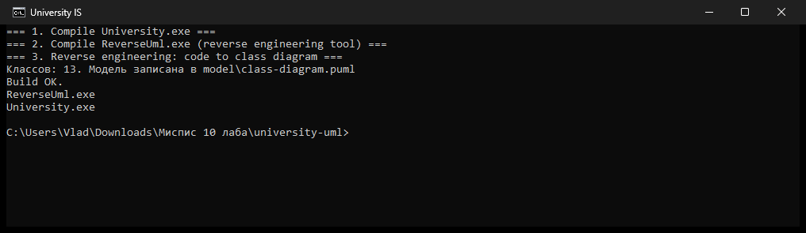
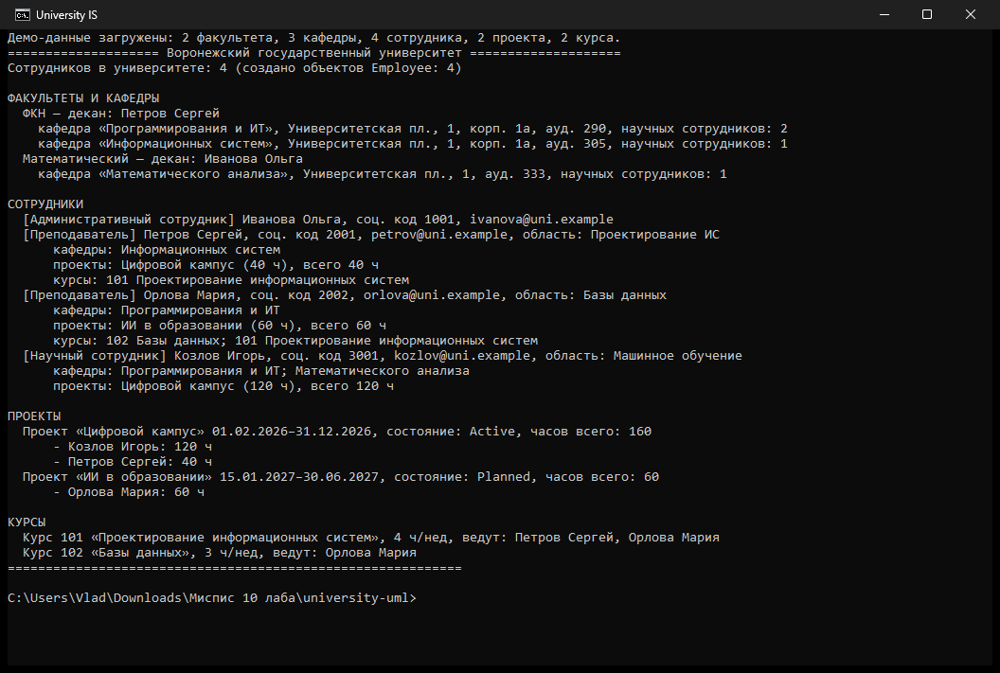
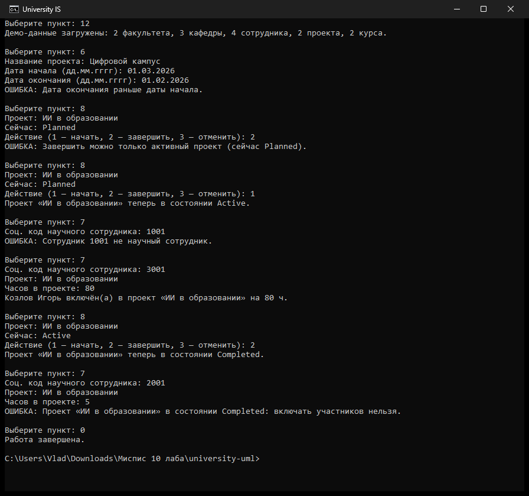
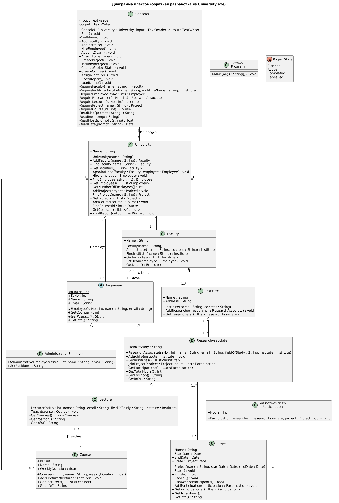
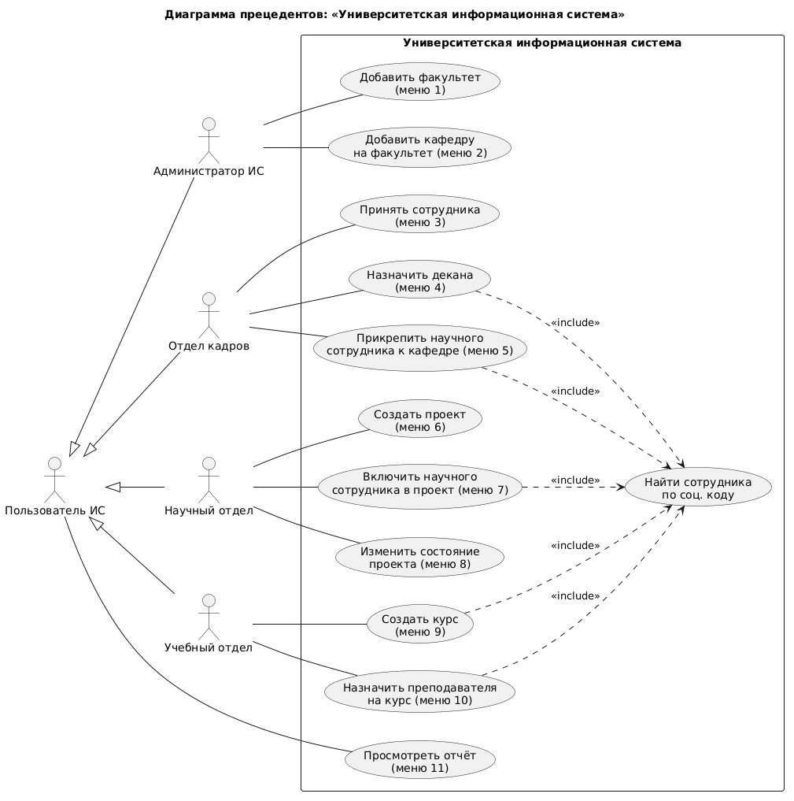
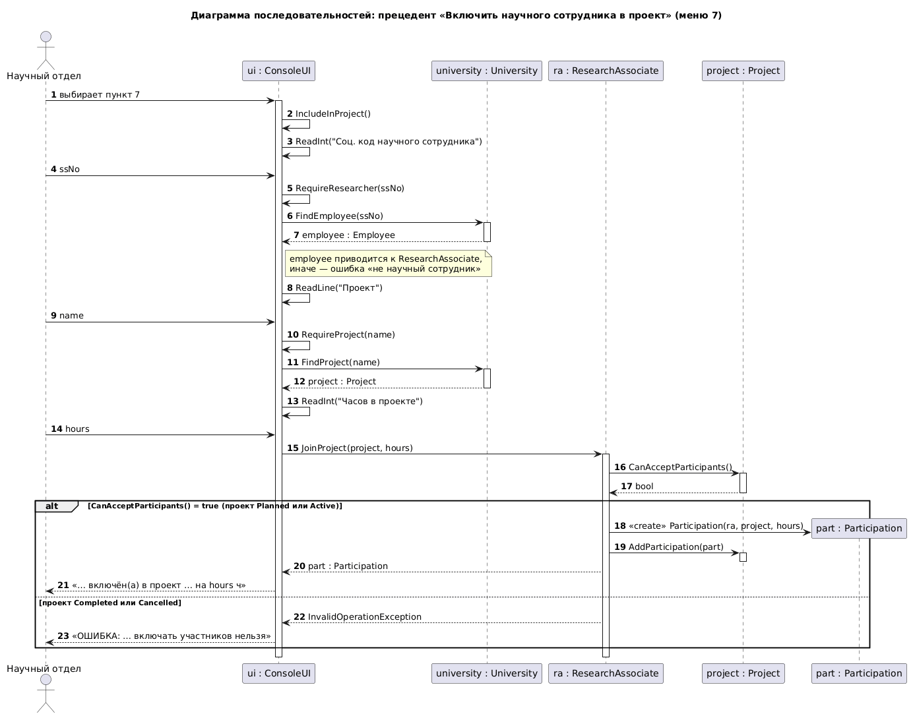
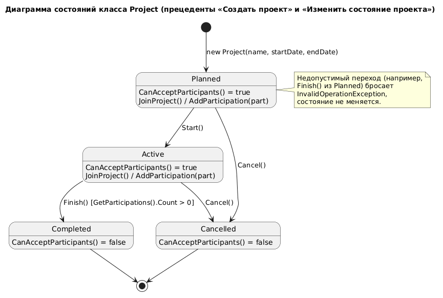
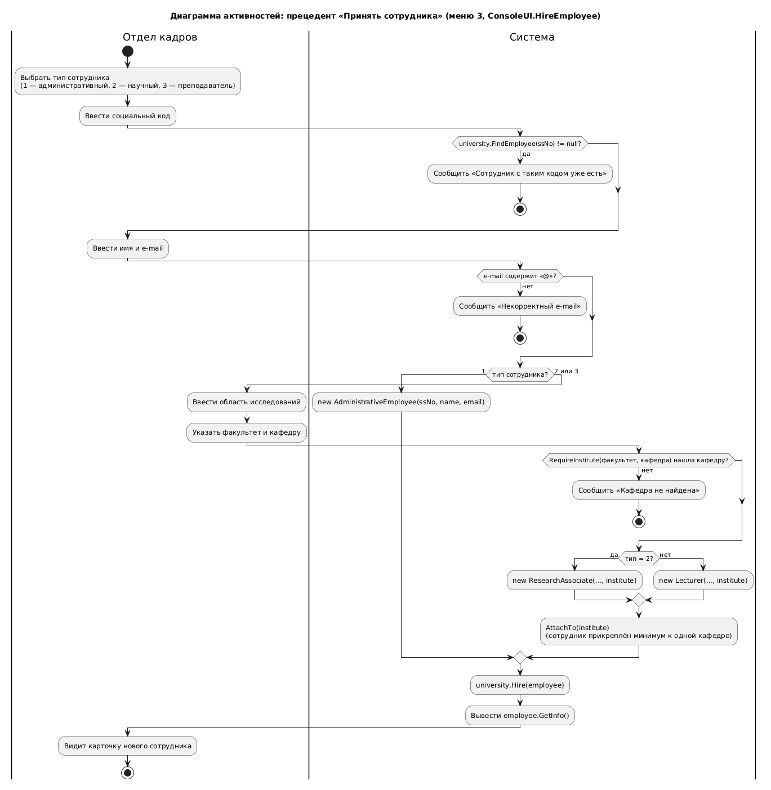

# Лабораторная работа 10. UML-моделирование и реинжиниринг

**«Университетская информационная система»**. Курс «Проектирование информационных систем», ВГУ ФКН.

Язык: **C#** (.NET Framework 4.x). UML-модели: **PlantUML** (`model/*.puml`), картинки — `diagrams/`.
Задание разрешает «любое другое средство UML-моделирования, допускающее генерацию кода и выполнение модели». Обратная разработка (код → диаграмма классов) сделана своим инструментом `tools/ReverseUml.cs`: он читает скомпилированный `University.exe` через рефлексию и пишет `model/class-diagram.puml`.

## Как собрать и запустить

Ничего устанавливать не нужно: компилятор C# `csc.exe` входит в .NET Framework 4.x, который есть в любой Windows 10/11.

```bat
build.bat                                      :: компиляция + обратная разработка
bin\University.exe                             :: интерактивное меню
bin\University.exe --demo                      :: демо-данные + отчёт
bin\University.exe < tests\scenario.txt        :: сценарий из файла
bin\University.exe < tests\scenario-states.txt :: ошибки ввода и смена состояний проекта
```

`build.bat` делает три шага:
1. компилирует `src\*.cs` → `bin\University.exe`;
2. компилирует `tools\ReverseUml.cs` → `bin\ReverseUml.exe`;
3. запускает обратную разработку: `University.exe` → `model\class-diagram.puml`.

## Структура

| Папка | Что внутри |
|---|---|
| `src/` | исходный код системы (13 типов) |
| `src/Uml/` | атрибуты `[Relation]` и `[AssociationClass]`: вид отношения и кратности, которые нельзя вывести из кода (агрегация/композиция) |
| `tools/ReverseUml.cs` | инструмент обратной разработки (рефлексия → PlantUML) |
| `model/` | UML-модели: классы (сгенерирована из кода), прецеденты, последовательность, состояния, активность |
| `diagrams/` | те же диаграммы в PNG и SVG |
| `tests/` | входные сценарии для запуска |
| `screenshots/` | скриншоты компиляции и выполнения + полные логи запусков |

## Шаг 1–2. Текстовый анализ: классы и атрибуты

| Класс (существительное-кандидат) | Атрибуты |
|---|---|
| University — университет | name |
| Faculty — факультет | name |
| Institute — кафедра | name, address |
| Employee — сотрудник (абстрактный) | ssNo (social security number), name, email, counter (number of employees, static) |
| AdministrativeEmployee — административный персонал | — |
| ResearchAssociate — научный сотрудник | fieldOfStudy (область исследований) |
| Lecturer — преподаватель | — |
| Project — проект | name, startDate, endDate (+ state — для диаграммы состояний) |
| Participation — участие в проекте (класс-ассоциация) | hours |
| Course — курс | id (unique number), name, weeklyDuration |

## Шаг 3. Отношения

| Предложение из задания | Отношение |
|---|---|
| «Существует различие между научным и административным персоналом» | **обобщение**: Employee ← AdministrativeEmployee, Employee ← ResearchAssociate |
| «Некоторые научные сотрудники могут вести курсы. Тогда они называются преподавателями» | **обобщение**: ResearchAssociate ← Lecturer |
| 1. «Университет состоит из множества факультетов, которые разделены на кафедры» | **композиция**: University ◆— 1..* Faculty, Faculty ◆— 1..* Institute (кафедра не существует без факультета: создаётся только `Faculty.AddInstitute`) |
| 2. «Руководителем каждого факультета является декан, который является сотрудником» | **ассоциация** leads: Employee 1 (+dean) — 0..1 Faculty |
| 3. «Каждый научный сотрудник прикреплён по крайней мере к одной из кафедр» | **агрегация**: Institute 1..* ◇— 1..* ResearchAssociate (сотрудник существует отдельно от кафедры, но без кафедры его не создать — кафедра передаётся в конструктор) |
| 4. «Научный сотрудник может быть вовлечён в проекты на определённое количество часов» | **ассоциация** с **классом-ассоциацией** Participation(hours): ResearchAssociate 1..* — 0..* Project |
| 5. «Некоторые научные сотрудники могут вести учебные курсы» | **ассоциация** teaches: Lecturer 1..* — 1..* Course |

## Шаг 4. Методы классов

Основные методы (полный список — на диаграмме классов):
`University.AddFaculty / Hire / FindEmployee / AppointDean / AddProject / FindProject / AddCourse / FindCourse / PrintReport`,
`Faculty.AddInstitute / SetDean / GetDean`, `Institute.AddResearcher`,
`ResearchAssociate.AttachTo / JoinProject / GetTotalHours`, `Lecturer.Teach`, `Course.AddLecturer`,
`Project.Start / Finish / Cancel / CanAcceptParticipants / AddParticipation`,
`Employee.GetCounter (static) / GetPosition (abstract) / GetInfo`.

## Шаги 5–6. Код, ввод/вывод, компиляция и выполнение

Консольное меню: каждый пункт — один прецедент. Правила модели проверяются в коде: декан руководит не более чем одним факультетом, научный сотрудник не создаётся без кафедры, участника нельзя добавить в завершённый или отменённый проект, переходы состояний проекта проверяются.







Полные логи: `screenshots/run-demo-log.txt`, `run-scenario-log.txt`, `run-states-log.txt`.

## Шаг 7. Обратная разработка → диаграмма классов

Диаграмма ниже **не нарисована руками**, а сгенерирована из скомпилированного кода командой
`bin\ReverseUml.exe bin\University.exe UniversityIS model\class-diagram.puml`:
классы, поля, свойства, конструкторы и методы с типами, видимость (`+ - #`), `{static}`, `{abstract}`, наследование — через рефлексию; вид отношения и кратности — из атрибутов `[Relation]` в коде.



## Шаг 8. Поведенческие диаграммы

Все диаграммы согласованы с кодом и между собой: объекты на диаграмме последовательностей — объекты классов с диаграммы классов, сообщения — существующие методы, каждая поведенческая диаграмма относится к своему прецеденту.

### Диаграмма прецедентов

Прецеденты = реализованные функции (пункты меню 1–11). «Найти сотрудника по соц. коду» включается (`<<include>>`) в прецеденты, которые ищут сотрудника (`University.FindEmployee`). Пункт 12 «демо-данные» — тестовое средство, а не прецедент.



### Диаграмма последовательностей — прецедент «Включить научного сотрудника в проект»



### Диаграмма состояний класса Project — прецеденты «Создать проект», «Изменить состояние проекта»



### Диаграмма активностей — прецедент «Принять сотрудника»


